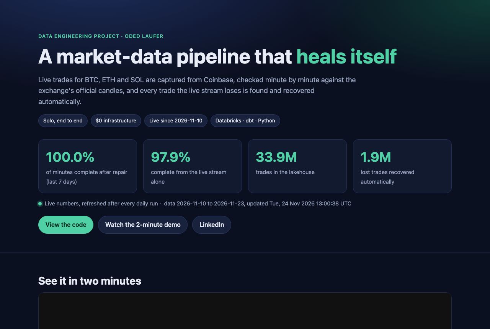
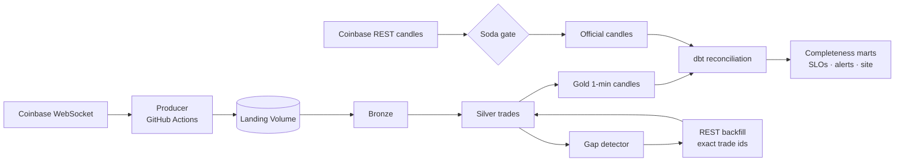
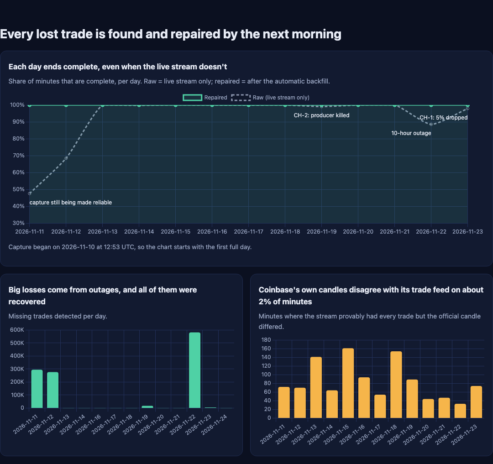

# Crypto Recon Lakehouse

**A market-data pipeline that heals itself.** Live Coinbase trades for BTC, ETH and SOL are
captured, checked minute by minute against the exchange's official candles, and every trade the
live stream loses is found by its trade id and recovered automatically.

**[Live site](https://odedlaufer.github.io/crypto-recon-lakehouse/)** ·
**[2-minute demo video](https://odedlaufer.github.io/crypto-recon-lakehouse/#demo)** ·
[dbt docs](https://odedlaufer.github.io/crypto-recon-lakehouse/dbt/) ·
[Data-quality report](https://odedlaufer.github.io/crypto-recon-lakehouse/elementary/)

| | Last 7 days (2026-11-24) |
| --- | --- |
| Minutes complete after automatic repair | **100%** |
| Minutes complete from the live stream alone | 97.9% |
| Trades in the lakehouse | 33.8 million |
| Lost trades recovered automatically | 1.92 million (975 gaps, 0 unrepairable) |

Solo project, end to end, on **$0 infrastructure** (Databricks Free Edition and GitHub), live
since 2026-11-10. The site's numbers refresh after every daily run.



## Why it matters
Coinbase's documentation warns that messages on its live trade channel can be dropped and that
consumers must detect the gaps and backfill them
([WebSocket overview](https://docs.cdp.coinbase.com/exchange/websocket-feed/overview)). Most
pipelines store whatever arrives, so everything built on them is quietly incomplete. This one
proves completeness against an independent source and repairs what is missing, keeping both the
before and the after.

## How it works



1. **Capture**: a Python producer (pydantic-validated, Docker-ready) streams trades and heartbeats
   in GitHub Actions capture windows and lands 10-minute JSONL batches in a Unity Catalog volume. A
   watchdog restarts capture if it stops.
2. **Refine**: one Lakeflow Declarative Pipeline builds bronze, silver and gold: deduplicated
   trades, expectations with a quarantine, and 1-minute candles.
3. **Reconcile**: dbt compares every product-minute with Coinbase's official candles, which pass a
   Soda write-audit-publish gate first.
4. **Detect**: trade ids are consecutive per product, so any jump is a provable gap (`ops.gaps`).
5. **Repair**: the exact missing ids are fetched from the REST API (nearby gaps in one request),
   loaded, and the minutes reconciled again.
6. **Observe**: SLO dashboard (Databricks AI/BI), Elementary anomaly tests, source freshness, Slack
   alerts, and the public site.

### Reconciliation statuses (per product-minute)
| Status | Meaning |
| --- | --- |
| `MATCH` | Stream candle equals the official candle (volume within ±0.01%) |
| `OFFICIAL_MISMATCH` | The stream provably has every trade, yet the official candle differs (ADR-012) |
| `VOLUME_DRIFT` / `PRICE_MISMATCH` | The stream is incomplete or differs |
| `MISSING_IN_STREAM` / `MISSING_IN_BATCH` | Only one side has the minute |

Both `status_before_repair` (first verdict) and `status_after_repair` (latest) are kept, so the
effect of every repair is measurable.



## Proven by breaking it on purpose
| Test | Injected | Result |
| --- | --- | --- |
| CH-1 | 5% of trades dropped for 20 minutes (899 trades) | 853 gaps detected, all repaired within a day; exposed a backfill limit, fixed (nearby gaps fetched together) |
| CH-2 | Producer killed for 10 minutes (17,740 trades) | Detected and repaired by the next run, no one involved |
| CH-3 | Negative price, zero size, bad side, future timestamp, unknown product, broken JSON | All 7 quarantined by the exact rule; none reached silver |
| CH-4 | Official candle with high below low | Soda gate failed, publish blocked, published data untouched |
| Integration test | One recorded hour with 3 known gaps, replayed in its own catalog | Exactly those gaps, same result every run (4/4 checks) |

Details: [docs/chaos.md](docs/chaos.md), [docs/integration-test.md](docs/integration-test.md).
`make demo` runs a live version of CH-3 on screen.

## Data quality
Checks at every layer, each with a defined action: producer schema validation (rejected file),
Lakeflow expectations with quarantine tables (`dq05` to `dq08`, `dq15`), a Soda data contract as the
write-audit-publish gate for official candles (DQ-11 to DQ-14), dbt tests and enforced contracts on
every mart, source freshness, Elementary anomaly detection, and data alerts for the completeness SLO
and unrepairable gaps. Every run, check and flush writes a row to the `ops` schema.

## Reliability targets (PRD §2)
| SLO | Target |
| --- | --- |
| Repaired completeness | ≥ 99.9% |
| Freshness at load | ≤ 30 min (ADR-011) |
| Producer latency p95 | < 90 s |
| Gap repair time p95 | < 24 h |
| Quarantine rate | < 0.1% |
| Batch gate pass rate | 100% |
| Pipeline success rate | ≥ 95% |

Measured continuously on the dashboard and the site. The 7-day unattended run (2026-11-24 to
2026-11-30) is the Phase 5 gate; its results go here and in [docs/phase-gates.md](docs/phase-gates.md).

## Decisions
Every decision is an ADR in [docs/adr](docs/adr), including the ones that did not work out.
Highlights:
- **ADR-001** Capture outside Databricks: Free Edition has no outbound internet or always-on compute.
- **ADR-002** Gap detection by trade-id continuity, after measuring that ids are consecutive.
- **ADR-004** Soda data contracts for the write-audit-publish gate (licence documented).
- **ADR-011** 10-minute landing files: per-30-second files exhausted the free quota.
- **ADR-012** A separate status for the exchange's own candle errors.
- **ADR-015** Continuous deployment to dev; prd kept deployable but not run.

## Run it yourself
Prerequisites: a Databricks workspace (Free Edition works) with a SQL warehouse, the
[Databricks CLI](https://docs.databricks.com/dev-tools/cli/install.html) logged in to it,
[uv](https://docs.astral.sh/uv/), and the GitHub CLI.

1. Create the catalog `crypto_dev` in the workspace (schemas and volumes come from the bundle).
2. Replace this workspace's values with yours: the host `dbc-c6f5458b-d402.cloud.databricks.com`
   and the warehouse id `8330a90a8089093e` (in `databricks.yml`, `dbt/profiles.yml`,
   `.github/workflows/` and `scripts/`).
3. Install and deploy:
   ```bash
   make setup
   make deploy
   make run-producer ARGS="--duration-seconds 60"   # local capture test, files stay local
   ```
4. For the scheduled system: a GitHub environment `dev` with the variable `DATABRICKS_HOST` and the
   secrets `DATABRICKS_TOKEN` and `SLACK_WEBHOOK_URL`, and GitHub Pages set to "GitHub Actions".

Daily operation, backfills, token rotation and recovery: [docs/runbook.md](docs/runbook.md).

| Command | Purpose |
| --- | --- |
| `make lint` / `make test` | pre-commit hooks / pytest |
| `make deploy TARGET=dev` | deploy the Databricks Asset Bundle |
| `make backfill START=… END=…` | fetch official candles for a date range |
| `make dbt ARGS="build"` | run dbt |
| `tests/integration/run_it.sh` | end-to-end integration test (`it` target) |
| `make demo` / `make demo-video` | live demo / record the demo video |

## Repository
| Path | Contents |
| --- | --- |
| `producer/` | WebSocket producer, batching, metrics, Dockerfile |
| `fetchers/` | REST candles and gap backfill |
| `libs/common/` | Volume upload, SQL, Slack notify, config |
| `databricks/` | Lakeflow pipeline, jobs (candles WAP, Soda audit) |
| `dbt/` | Staging, reconciliation, gaps, marts, tests, contracts, Elementary |
| `resources/`, `databricks.yml` | Databricks Asset Bundle (dev, it, prd) |
| `chaos/` | CH-1 to CH-4 fault injection |
| `tests/` | Repo, chaos and integration tests (fixture, golden results) |
| `web/`, `scripts/` | Public site, data export, demo |
| `.github/workflows/` | capture, watchdog, daily-batch, deploy, docs, chaos, integration-test, ci |

## Trade-offs, and what a paid platform would change
The free tier shapes the design: capture runs in GitHub Actions windows, data lands as files and is
loaded once a day, and only dev runs. With a paid platform: Kafka or Kinesis instead of landing
files, a continuously running pipeline for second-level freshness, capture on a managed container
service with health checks, and separate dev and prod workspaces with service principals.

## More
- [Phase gates and results](docs/phase-gates.md) · [Runbook](docs/runbook.md) ·
  [Chaos tests](docs/chaos.md) · [Integration test](docs/integration-test.md)
- Screenshots: [dbt docs](docs/img/dbt-docs.png) · [Elementary](docs/img/elementary.png) ·
  [How it works](docs/img/site-how-it-works.png) · [Chaos and SLOs](docs/img/site-proven.png) ·
  [SLO dashboard](docs/img/dashboard.png)

Built by Oded Laufer · [LinkedIn](https://linkedin.com/in/oded-laufer)
